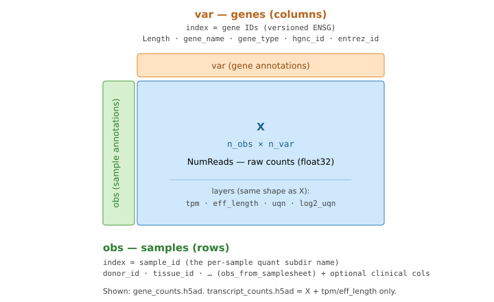
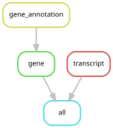

# bulk-rna-preprocessing

A small, reusable [Snakemake](https://snakemake.github.io) workflow that
aggregates a tree of per-sample [Salmon](https://combine-lab.github.io/salmon/)
quantifications into **gene-** and **transcript-level** AnnData (`.h5ad`) objects
with normalisation layers, an obs sample/clinical join, and GENCODE + HGNC var
annotation. This is the bulk-RNA (WTS, whole-transcriptome sequencing)
preprocessing stage.

It is the **bulk-RNA analogue of `chromium-preprocessing`**: the same lab
"a stage is a product" pattern (config-driven, tested, containerisable; runs
standalone or as a git submodule inside a DVC-tracked dataset). It is the
standalone extraction of the `preprocessing` stage that lived inside
`brca_mega_atlas-data`.

**Assay / subtyper-agnostic.** This stage stamps generic gene identifiers only
(`gene_name`, `gene_type`, `hgnc_id`, `entrez_id`).

## Outputs

Each output is an [AnnData](https://anndata.readthedocs.io/) object — a counts
matrix `X` with per-row (`obs`) and per-column (`var`) annotation and extra
same-shaped `layers`:



`gene_counts.h5ad`

| slot | content |
|------|---------|
| `X` | `NumReads` (raw counts, float32) |
| `layers["tpm"]` | TPM |
| `layers["eff_length"]` | EffectiveLength |
| `layers["uqn"]` | upper-quartile normalised counts (UQ scaled to `params.uqn.target`) |
| `layers["log2_uqn"]` | `log2(UQN)` with 0 → 1 substitution |
| `obs` index | `params.sample_id` (the per-sample quant subdir name) |
| `obs[...]` | `params.obs_from_samplesheet` columns + optional clinical join |
| `var` index | gene IDs (from the quant `Name` column, e.g. versioned ENSG) |
| `var.Length` | gene length |
| `var.gene_name` / `gene_type` / `hgnc_id` | GENCODE GTF annotation |
| `var.entrez_id` | NCBI Entrez gene ID (HGNC complete set, via `hgnc_id`) |

`transcript_counts.h5ad` — `X` / `layers.tpm` / `layers.eff_length`, `obs` as
above, `var` index = transcript IDs. No annotation / UQN / clinical join.

## Layout

```
config/config.yaml              # configuration template (parameterised)
pyproject.toml                  # installable package (src/ layout; `brp` console command)
env/environment.yaml            # conda env for the aggregation step
containers/Dockerfile           # containerised CLI
src/bulk_rna_preprocessing/
  lib.py                        # the library (counting / UQN / annotation / join)
  _steps/{gene_annotation,gene,transcript}.py  # one typed run() per stage
  _dispatch.py                  # binds run() from snakemake OR CLI (vendored; see docs/dev)
  _cli.py  __main__.py          # CLI built from the same run() signatures
workflow/
  Snakefile                     # rules: gene_annotation -> gene; transcript (rule name == step module)
  rules/common.smk
  scripts/_run.py               # one generic shim -> dispatch_by_rule() (snakemake.rule -> _steps.<rule>.run)
  schemas/config.schema.yaml    # validated at workflow start
profiles/workflow/config.yaml   # per-rule resources, use-conda
test/                           # self-contained synthetic fixture + golden + comparator
.tests/ci/                      # data-independent CI config + placeholder setup
run.sh  run_test.sh
```

## Rule graph



`gene_annotation` → `gene`, plus `transcript`, all feeding `all`. Every rule runs
the generic `scripts/_run.py` shim, which `dispatch_by_rule` routes to the matching
`_steps/<rule>.run` (see the `# step:` breadcrumb on each rule).

## Configure

Everything dataset-specific is in `config/config.yaml` (schema:
`workflow/schemas/config.schema.yaml`): all input/output paths, the sample-id
column, an optional samplesheet row filter, which samplesheet + clinical columns
land in `obs`, the UQN quantile/target, and the (optional) clinical obs-join. So
both `bcarc_wts` and `brca_mega_atlas-data` drive one implementation — no paths
are hard-coded.

Omit the `params.clinical` block (and `deps.clinical`) to produce h5ads with no
clinical obs columns.

## Run

```bash
# standalone (builds config/config.yaml's outputs)
./run.sh

# as a submodule, point at the parent repo's config
BULK_RNA_PREPROCESSING_CONFIG=/path/to/parent/config.yaml ./run.sh

# or run a single stage by hand via the CLI (one process, no Snakemake) — see below
brp --help
```

The aggregation reads every per-sample quant file into memory, so on a full
cohort it is the memory-heavy step — run it via your cluster scheduler (the NCI
profile / PBS), not on a login node.

## Running a stage manually (CLI)

Each stage is also a CLI subcommand, built from the *same* typed `run()` the
Snakemake rules dispatch to (via `_dispatch.build_cli`), so the CLI and the
workflow can't drift. Use it to run or debug one stage without Snakemake.

Invoke it as the installed console command, or from a checkout via `python -m`:

```bash
pip install .            # -> the `brp` command
brp --help

# from a checkout without installing:
PYTHONPATH=src python -m bulk_rna_preprocessing --help
```

Three subcommands; every option is derived from the step's signature. Paths are
required; `-c/--config` takes the workflow config as **YAML or JSON** (only the
stages that read `params`/`deps.clinical` need it); `-l/--log` mirrors the
telemetry banner to a file.

```bash
# 1. GENCODE GTF -> gene annotation TSV (run first; no config needed)
brp gene-annotation -g gencode.v39.annotation.gtf.gz -a genes.tsv

# 2. gene-level counts -> annotated, UQN-normalised h5ad
brp gene -i counts/individual -s samplesheet.csv \
    --hgnc-complete-set hgnc_complete_set.txt \
    -a genes.tsv -o gene_counts.h5ad -c config/config.yaml

# 3. transcript-level counts -> h5ad
brp transcript -i counts/individual -s samplesheet.csv \
    -o transcript_counts.h5ad -c config/config.yaml
```

Short flags: `-i` counts dir, `-s` samplesheet, `-g` GENCODE GTF, `-a` annotation
TSV, `-o` output h5ad, `-c` config, `-l` log (long names always work too; see
`brp <step> --help`).

## Test

```bash
pytest test/               # fast unit tests over the library + stage run() functions
./run_test.sh --check      # end-to-end: build from test/fixtures/, compare to test/golden/
```

Two tiers: `test/test_unit.py` imports the library and each stage's `run()` and
checks them on the committed fixtures with no Snakemake (the payoff of keeping the
logic in an importable library — see `trident`'s `docs/testing.md`); `run_test.sh
--check` covers the full DAG + conda envs against `test/golden/`.

A tiny committed synthetic 3-sample cohort (`test/fixtures/`) with a golden
output (`test/golden/`) produced by this code. `test/compare_h5ad.py` is a
NaN-aware h5ad comparator (shapes, X/layer max-abs-diff, obs/var column equality;
`--ignore-var-cols` for deliberately-changed columns). `.tests/ci/` holds a
data-independent config + `setup_placeholders.sh` for lint / schema / dry-run CI.

## Provenance

Faithful, behaviour-preserving extraction of
`brca_mega_atlas-data/modules/preprocessing/scripts/preprocess.py`. Verified
`IDENTICAL` to the original (same inputs) on `X`, all layers, all `obs` columns
and all remaining `var` columns — differing only by the intentionally-dropped
PAM50 var columns. See `CITATION.cff`.
